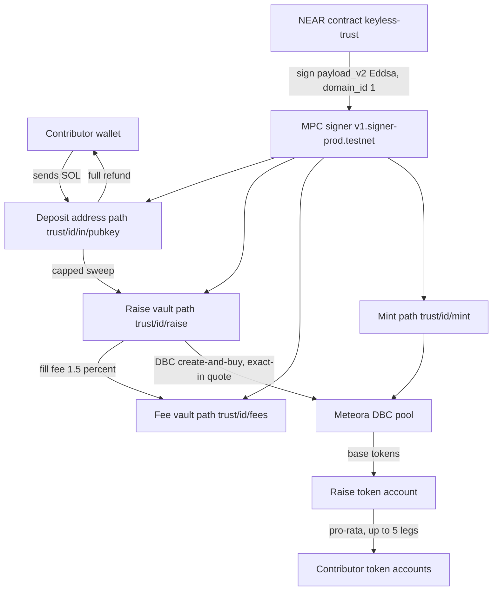
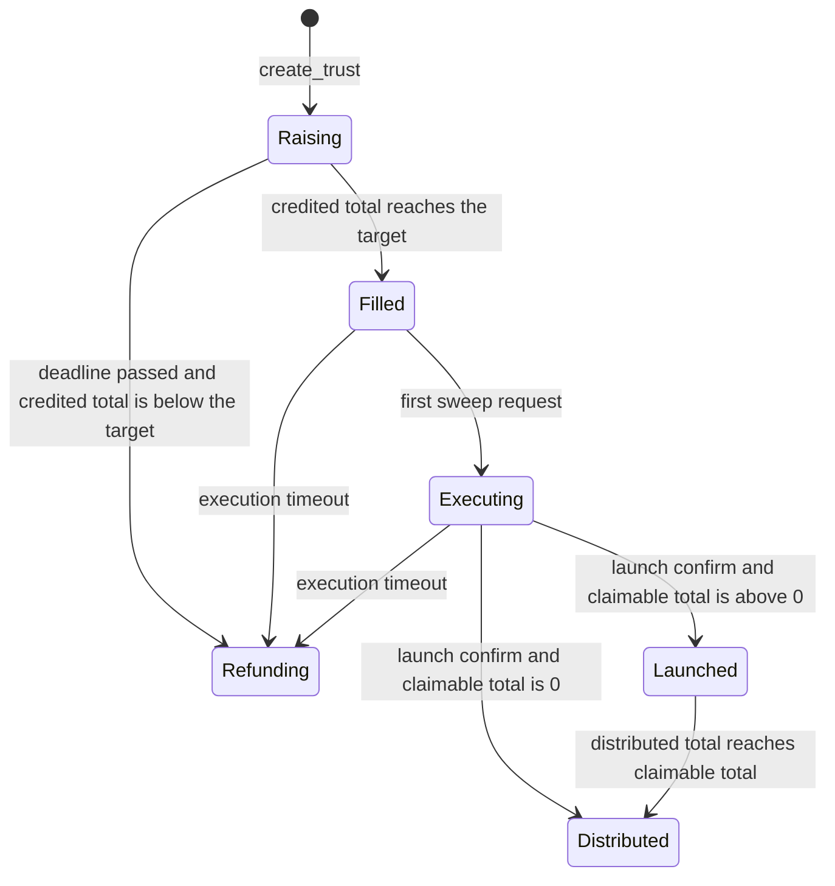

# Keyless Trust

NEAR Hackathon 2026, track `memecoins` ("Memecoins With Mechanics"). NEAR testnet and Solana devnet only.

**Live demo: https://trust.ethics.ltd (testnet/devnet)**

**Demo post:** https://x.com/ethicslaunch/status/2120472863178461406 (@ethicslaunch). This is the public demo post for the submission. The hosted product demo is https://trust.ethics.ltd.

The production site is HTTPS on Vercel, on the custom domain above. It reads NEAR testnet and Solana devnet. Fallback: https://keyless-trust.vercel.app.

## Summary

Keyless Trust is a NEAR contract that runs a community token raise on Solana. The contract owns every Trust's Solana addresses through Chain Signatures: one deposit address per contributor, the raise vault, the fee vault, and the mint. It asks the multi-party computation (MPC) signer `v1.signer-prod.testnet` for an Ed25519 signature (domain id 1). It signs only these transaction shapes: a full refund, a capped sweep, a Meteora Dynamic Bonding Curve (DBC) create-and-buy that uses the in-contract exact-in quote and a 1.5% fill fee, and a pro-rata distribution. No person or server holds a vault key. A relayer pays NEAR gas and the Solana fee. The destination of every signed transfer is an address the contract derived or the contributor pubkey stored at `register`.



Chain Signatures is NEAR's MPC signing service. The derived Ed25519 public key, with the `ed25519:` prefix removed, is the Solana address. SOL is Solana's native token. Lamports are the base unit: 1 SOL is 1,000,000,000 lamports.

## Problem

A community raise still needs a Solana address that can move the pooled SOL. Today that address is a server key, a founder wallet, or a multisig. Whoever holds it can change the destination.

This contract removes that holder. The raise rules live in the NEAR contract. The contract will sign a Solana message only after the shape checker accepts it. A backend can delay a step. It cannot add a destination.

## How it works

### Trust lifecycle

`create_trust` starts a Trust in `Raising`. Parameters are fixed on that call: target in lamports, deadline, `cap_bps`, fill fee (default 150 basis points, which is 1.5%), execution timeout (default 24 hours), DBC config pubkey, token name, symbol, and URI (URI at most 60 characters), watcher account, and the DBC curve. `cap_bps` is required and must be from 1 to 10,000. 100 basis points is 1% of the target per wallet. The caller attaches at least 0.01 NEAR.



`report_deposit` is watcher-only. In `Raising` the contract credits `min(amount, remaining per-wallet cap, remaining target)` and marks the rest as overflow. After `Raising`, a reported deposit is all overflow. When `credited_total` reaches the target, the state becomes `Filled`.

The first accepted sweep moves `Filled` to `Executing` and starts the execution clock. Sweeps continue until `swept_total` equals `credited_total`. The watcher then requests the launch. `confirm_launch_outcome` sets `Launched`, or `Distributed` when every floor share is 0.

`try_timeout` is permissionless. Views also project the timeout, so `get_trust` can show `Refunding` before the stored state is written. `Launched` and `Distributed` do not time out into `Refunding`.

`register(trust_id, solana_pubkey)` is permissionless and costs 0.005 NEAR (excess is refunded). It is rejected in `Launched`, `Refunding`, and `Distributed`. Refunds can only go to the pubkey that was registered.

### Path derivation

Callers do not supply vault addresses. `create_trust` calls `derived_public_key` on `v1.signer-prod.testnet` with `domain_id` 1, `predecessor` equal to the contract account, and a path the contract builds:

| Path | Address |
| --- | --- |
| `trust/<id>/raise` | Raise vault. Sweep destination, launch buyer, pool creator, leftover receiver. |
| `trust/<id>/fees` | Fee vault. Receives the fill fee. Intended `feeClaimer` on the DBC config. |
| `trust/<id>/mint` | Base mint. The contract signs the launch message with this key. |
| `trust/<id>/in/<pubkey>` | Deposit address for that contributor pubkey. |

`<pubkey>` is the contributor's base58 Solana public key. `request_derived_key` can ask again for `raise`, `fees`, `mint`, or `in`. Sweep and refund reject a transfer whose source is not the stored derived address.

A read-only check on 3 Nov 2026, predecessor `example.testnet`, path `trust/1/raise`, returned `ed25519:B4paagQ87U6kmpn3AoXYaZMQVsFCJbZtjh8tBoKDDXwj`. That predecessor is the plan check. It is not the deployed contract. Addresses for the deployed contract differ because derivation includes the predecessor account.

### Pending ledger

A sign request does not debit the ledger. The contract stores a pending row keyed by the hex SHA-256 of the unsigned Solana message bytes.

- Each lock is `(trust id, contributor, kind)`. A new sign increments a per-lock nonce.
- The row expires 150 seconds after it is created (`PENDING_EXPIRY_NS` = 150,000,000,000 ns). That window is past the Solana recent-blockhash lifetime (about 60 to 90 seconds).
- Swept lamports, refunded lamports, fill fee paid, `claimable_total`, and distributed tokens are written only when the named watcher calls `confirm_transfer` or, for launch, `confirm_launch_outcome`.
- Anyone may call `release_pending` after expiry. The row stays. A later sign of the same lock marks the released row superseded. An honest confirm of the original hash, with no later sign, still books.
- `seen_sigs` rejects a reused Solana signature. `consumed_hashes` rejects a message hash that already settled.
- If the MPC callback fails, the contract reverts the nonce and clears the pending row.

`request_sweep`, `request_fill_fee`, and `request_launch` are watcher-only, so a stranger cannot lock those steps. `request_refund`, `request_raise_refund`, and `request_distribute` are permissionless. Each sign request attaches 0.01 NEAR. Excess is refunded. The contract's call to `sign` attaches 1 yoctoNEAR and 30 TGas. A direct testnet `sign` burnt 8.84 TGas.

`confirm_transfer` and `confirm_launch_outcome` take 1 yoctoNEAR and the watcher account. `report_deposit` takes 1 yoctoNEAR and the watcher account.

### Allowed shapes

Every message is a legacy Solana message. The parser rejects a versioned message (the high bit of the first byte is set), so address lookup tables never apply. Trailing bytes after the message are rejected. Account 0 is the fee payer. The relayer may be the fee payer. The vault may be the fee payer when it is also the transfer source.

Shape D rejects a message longer than 1,232 bytes. That is the Chain Signatures payload limit for this Ed25519 path. The measured DBC messages in `docs/spikes.md` are under that limit. Distribution is the shape that enforces it in code.

**Refund (deposit).** Allowed while the contributor has a refundable balance. In `Raising`, `Filled`, and `Executing` that balance is overflow only. In `Refunding` it is credited plus overflow minus swept, minus a pending sweep of the same deposit. In `Launched` and `Distributed` it is zero. The System `Transfer` source is the stored deposit address. The destination is the contributor pubkey. The amount must equal the full refundable balance. If a smaller transfer would leave the account below the rent-exempt minimum of 890,880 lamports, the contract refunds the full remaining balance so the account can close. Optional ComputeBudget instructions may sit beside the transfer. Any other extra instruction is rejected. The signer path is `trust/<id>/in/<pubkey>`.

**Raise refund.** `Refunding` only. Source is the raise vault. Destination is the contributor pubkey. Amount is the full raise-refundable balance, which is swept lamports minus what was already refunded from the raise. Signer path is `trust/<id>/raise`.

**Capped sweep.** `Filled` or `Executing`. Watcher-only. One System `Transfer` from the stored deposit address to the stored raise vault. Amount is at most credited minus already swept, minus a live pending sweep. The per-wallet cap was applied at `report_deposit`, so a sweep cannot move more than that credit. Signer path is `trust/<id>/in/<pubkey>`.

**Fill fee.** `Executing`. Watcher-only. One System `Transfer` from the raise vault to the fee vault for the exact unpaid fill fee. The same transfer may instead sit inside the launch message. Default fee is `credited_total * 150 / 10,000`.

**DBC create-and-buy.** `Executing`, after `swept_total == credited_total` and no sweep or fill-fee pending. Watcher-only. The contract signs the same message twice, on `trust/<id>/raise` and `trust/<id>/mint`. Callers attach at least 90 TGas (`launch_attach_tgas`: two 30 TGas `sign` calls and a 20 TGas callback) and 0.01 NEAR.

The checker allows:

- Optional ComputeBudget instructions.
- At most one System transfer from the raise vault to the fee vault, for the exact fill fee, unless that fee is already paid.
- One System transfer from the raise vault to the raise wrapped-SOL associated token account (ATA), for `credited_total - fill fee`, then `SyncNative` on that ATA.
- Associated-token `CreateIdempotent` whose payer is the transaction fee payer (the relayer). The owner is the raise vault. The mint is wrapped SOL or the Trust mint. The ATA must be the derived address. The raise vault, the mint, and the fee vault cannot be the rent payer.
- `initialize_virtual_pool_with_spl_token` with the pinned accounts: config, mint, raise vault, name, symbol, and URI. The init payer is the relayer.
- One `swap` or `swap2`. `swap` data is exactly 24 bytes: amount in and `minimum_amount_out`. `swap2` data is exactly 25 bytes and `swap_mode` must be 0 (ExactIn). `minimum_amount_out` must equal the contract quote. The swap output ATA, pool, vaults, and event authority are derived and compared by index. Anchor's empty referral account must be the DBC program id. A real referral ATA is rejected.
- Optional `closeAccount` of the raise wrapped-SOL ATA, with destination and authority equal to the raise vault.

The DBC program id stored on the contract is `dbcij3LWUppWqq96dh6gJWwBifmcGfLSB5D4DuSMaqN` (program 0.2.2). Token-2022 is rejected. A second landing fails because the pool address already exists.

**Pro-rata distribution.** `Launched` only, after `tokens_bought` is stored. Permissionless. One MPC sign on `trust/<id>/raise`. Callers attach at least 60 TGas (`distribute_attach_tgas`) and 0.01 NEAR. The method checks the gas. Up to 5 legs. Each leg is an optional `CreateIdempotent` (payer is the relayer) and one Tokenkeg `TransferChecked` of exactly 10 bytes, decimals 6. The source is the raise vault's token ATA. The destination owner is the pubkey stored at `register`. The amount must equal that contributor's remaining floor share. No other instruction is accepted, including ComputeBudget. The trust moves to `Distributed` when `distributed_total >= claimable_total`.

The 70/20/10 creator-fee split is not implemented.

### In-contract quote

`quote_first_buy` is a port of `@meteora-ag/dynamic-bonding-curve-sdk` 2.0.0 exact-in, quote-to-base, for a brand-new pool. On a new pool the start square-root price is the curve's start price, the quote reserve is 0, and volatility is 0, so the dynamic fee is 0. There is no referral and no Token-2022 transfer fee.

`amount_in` is `credited_total` minus the fill fee. `request_launch` stores the quoted base output as `tokens_bought` and requires the swap's `minimum_amount_out` to equal it. A value of 1 is rejected. `confirm_launch_outcome` takes `(message_hash, solana_sig)` only. It recomputes the quote from the pending buy and requires it to equal the stored value. The output must be from 1 through `1_000_000_000 * 10^6` raw units (a 1,000,000,000 supply at 6 decimals).

`base_fee_mode` must be 0. That is the linear fee scheduler. With `enable_first_swap_with_min_fee` the numerator is `cliff_fee_numerator - number_of_period * reduction_factor`. With the flag off the first buy is still period 0, so the numerator is the cliff. `periodFrequency` does not change this quote and is not stored. Exponential scheduler and the rate limiter are rejected at `create_trust` (`only a linear fee scheduler is quoted`).

The curve is committed in `params_hash = sha256(config || 0 || name || 0 || symbol || 0 || uri || borsh(curve))`. NEAR cannot read the Solana config account. A stored curve that quotes high makes the swap fail the pinned `minimum_amount_out`. A stored curve that quotes low pays every floor from the smaller basis. Tokens above the quote stay in the raise ATA.

Golden vectors are in `contracts/keyless-trust/tests/fixtures/dbc_quotes.json`.

### Distribution math

Share for a contributor is `floor(tokens_bought * credited / credited_total)`. The basis is credited lamports, not swept lamports. Dust is `tokens_bought - sum(floors)`. It stays in the raise token account. It is not paid to a last recipient. When the credits sum to `credited_total`, each remainder is below 1 raw unit, so the dust is strictly less than the number of credited contributors.

`claimable_total` is that sum of floors. The contract requires `claimable_total <= tokens_bought`. Claim order does not change who can be paid. A leg pays the remaining floor (`share - distributed_tokens - live pending`). A message may include at most 5 such legs.

Views: `claimable(trust_id, contributor)` and `distribution_status` (`tokens_bought`, `claimable_total`, `distributed_total`, `dust_tokens`, decimals 6, Tokenkeg program id).

## Security model

The contract is the policy. The relayer builds an unsigned message and asks the contract to sign it. Tests in `contracts/keyless-trust` reject a message that breaks a pin. `docs/DECISIONS.md` records the same bugs found on earlier testnet builds.

### What was attacked live

| Attack | Where it showed up | What the contract does now |
| --- | --- | --- |
| Extra System transfer from the raise vault | Live hole on the m6 build (`docs/DECISIONS.md`) | The only System transfers from the raise vault are the exact fill fee to the fee vault and the exact wrap to the raise wrapped-SOL ATA. Tests: `request_launch_rejects_extra_raise_transfer`, `rejects_extra_system_transfer_from_raise`. |
| Redirected swap output | Live hole on the m6 build | The swap output ATA must match the derived raise token ATA. Test: `request_launch_rejects_redirected_swap_output`. |
| ExactOut swap | Live hole on the m7 build | `swap2` must be 25 bytes with `swap_mode = 0` (ExactIn). `swap` must be 24 bytes. Test: `rejects_swap2_exact_out_mode`. |
| Partial refund | Live hole on the m7 build | Refund and raise-refund amounts must equal the full refundable balance. Tests: `request_refund_rejects_partial`, `request_raise_refund_rejects_partial`. |
| `register` after launch | Live hole on the m6 build | `register` is rejected in `Launched`, `Refunding`, and `Distributed`. Tests: `register_rejects_after_launched`, `register_rejects_after_refunding`. |
| Over-reported `tokens_bought` | Live m9 (`0c27d3c`), trust 3 | On m9, `confirm_launch_outcome` took a watcher-supplied balance. The watcher set `tokens_bought` to 1.5 times the tokens the swap delivered. Contributor c5, with 30% of the credit, was booked `1400119995884` raw units, which is `466706665295` above a 30% share of the real balance. The raise account was left with about `1711257772746`, below a 60% floor of that balance. c4's later claim was signed on NEAR and the Solana transfer failed. On m10 the basis is the in-contract quote. Confirm takes no balance. Tests: `request_launch_rejects_min_out_one`, `request_launch_rejects_min_out_off_by_one`. |

Earlier ledger bugs (a refund whose source was the relayer, a late confirm after a re-sign, a refund signed against a pending sweep) are in `docs/spikes.md` with the testnet transaction ids. Those checks are in the current contract: the source must be the stored vault, a re-sign supersedes the released hash, and a pending sweep reduces `refundable` in `Refunding`.

### Trust assumptions that remain

- **MPC signer set.** The Chain Signatures nodes can collectively sign any payload for a derived key. That is the base assumption of NEAR Chain Signatures.
- **Watcher.** NEAR cannot read Solana. The watcher named at `create_trust` attests deposit credits through `report_deposit` and attests that a signed transaction landed through `confirm_transfer` and `confirm_launch_outcome`. A watcher can delay every step that needs it. A watcher can also skew credits among registered contributors by reporting the wrong deposit amounts. The watcher cannot set `tokens_bought`. The watcher cannot send SOL or tokens to an address the contract did not pin, and cannot redirect a claim off the pubkey stored at `register`. Anyone can run a second process and compare the NEAR logs with a Solana explorer. `confirm_*` still accepts only the named watcher.
- **Stranger delay.** `request_refund` is permissionless. A stranger who attaches the 0.01 NEAR sign deposit can lock one full refund for 150 seconds. The same deposit on `request_distribute` locks only the contributors named in that message, at most 5, for 150 seconds. Contributors left out of the message stay claimable. Sweep, fill fee, and launch stay watcher-only.
- **Fee scheduler.** Only the linear scheduler is supported. `create_trust` rejects any other `base_fee_mode`.
- **Stored curve vs the on-chain DBC config.** The contract quotes the curve it stored. It does not read the Solana config. A high quote fails the swap. A low quote under-allocates, and the extra tokens stay in the raise ATA.
- **Agents.** An agent can join today. `register` is permissionless: the caller attaches 0.005 NEAR and names a Solana pubkey. The contract does not ask who the caller is. An agent that holds its own NEAR account and its own Solana key can register, and can later request a refund or a distribution claim with those keys.
- **Sybil.** The cap is per wallet. `cap_bps` of 100 means one pubkey can be credited at most 1% of the target. One person can split across many wallets. One operator can split a contribution across many agent wallets, because there is no per-person identity check. That is enough for a demo. It is not a fairness guarantee.
- **DBC config.** The config is created once, outside the contract, and the Trust pins its pubkey. `feeClaimer` is expected to be the fee vault. `leftoverReceiver` is expected to be the raise vault. The contract does not enforce those two fields on the Solana account. It enforces the accounts inside the messages it signs.

Priority-fee price is not capped. ComputeBudget instructions are allowed on refund, sweep, fill fee, and launch. They are rejected on distribution. A priority fee is paid by the fee payer. When the relayer is the fee payer, the fee is not taken from the vault.

## Regulatory note

A pooled raise, where many people send money to buy a new token, may be treated as a collective investment or as a securities offering in some jurisdictions. Making the vault keyless changes who can move the funds. It does not change that legal character.

This repository is a NEAR testnet and Solana devnet demo. It is not an offering, not a sale, and not investment advice. It moves no mainnet value and promises no return. Any mainnet use needs legal advice in the operating jurisdictions. The longer note is in `docs/PLAN.md` section 10.

## Repository layout

| Path | What it is |
| --- | --- |
| `contracts/keyless-trust/` | NEAR contract. near-sdk 5.17.0. Parser, shape checkers, quote, MPC promises. |
| `relayer/` | TypeScript builders, one-shot scripts, and the long-running watcher/relayer. near-api-js and `@solana/web3.js`. |
| `app/` | Next.js web app. Trust list, create, contribute, actions, and Verify. Reads public testnet and devnet RPC. |
| `packages/ui/` | Design tokens, amount formatting, and `create_trust` validation shared with the app. |
| `scripts/` | `build-wasm.sh`, `deploy-testnet.sh`, and thin wrappers. The implementations live in `relayer/src`. |
| `docs/` | Plan, decisions, shapes, threat model, spike measurements, design tokens. |

## Quick start

### Prerequisites

- Rust 1.93.0, with the `wasm32-unknown-unknown` target (`rust-toolchain.toml`).
- Node.js 22 and pnpm 10.33.4 (`packageManager` in the root `package.json`). Continuous integration (CI) uses these versions.
- `binaryen` (`wasm-opt`) for the release WebAssembly build. CI installs it with `apt-get`.

No paid RPC and no funded account are required for the commands in the test section. Copy `.env.example` to `.env` only when you run a script that needs keys. Do not commit `.env`.

### Build

```bash
pnpm install --frozen-lockfile
scripts/build-wasm.sh
```

`scripts/build-wasm.sh` runs `cargo build -p keyless-trust --target wasm32-unknown-unknown --release` and then `wasm-opt -Oz` when `wasm-opt` is on `PATH`. `docs/DECISIONS.md` records the quote build as 600,020 bytes before `wasm-opt` and 339,351 bytes after.

The app build used in CI:

```bash
pnpm --filter @keyless-trust/ui build
pnpm --filter @keyless-trust/app build
```

### Test

CI (`.github/workflows/ci.yml`) runs:

```bash
cargo test --workspace
pnpm test
pnpm --filter @keyless-trust/relayer exec tsc --noEmit
pnpm --filter @keyless-trust/ui build
pnpm --filter @keyless-trust/app typecheck
pnpm --filter @keyless-trust/app build
```

`pnpm test` runs the relayer, `packages/ui`, and app tests. `cargo test -p keyless-trust` is included in `cargo test --workspace`.

`cargo test -p keyless-trust --test sandbox -- --ignored` documents a later near-workspaces recipe. CI does not run it. near-workspaces is not a default CI dependency.

There is no markdown lint job in CI.

### Web app

The hosted app is live at https://trust.ethics.ltd (custom domain, HTTPS, Vercel). The same deployment is at https://keyless-trust.vercel.app. Both read NEAR testnet and Solana devnet. Trust list, trust detail, and Verify work without a wallet.

To run that app locally:

```bash
pnpm dev:app
```

Open `http://localhost:3000`. Create, register, and the action page can submit a wallet transaction on testnet or devnet.

Environment variables, all public, all optional (defaults are in `app/src/lib/config.ts` and `.env.example`):

| Variable | Default |
| --- | --- |
| `NEXT_PUBLIC_CONTRACT_ID` | `m10.keyless-trust-dev-54ef71.testnet` |
| `NEXT_PUBLIC_NEAR_RPC_URL` | `https://rpc.testnet.near.org` |
| `NEXT_PUBLIC_SOLANA_RPC_URL` | `https://api.devnet.solana.com` |

There is no mainnet switch and no secret in the client.

To deploy the app on Vercel, set the root directory to `app`, turn on "include source files outside of the root directory", and use the install and build commands in `app/vercel.json`:

- Install: `cd .. && pnpm install --frozen-lockfile`
- Build: `cd .. && pnpm --filter @keyless-trust/app build`

`app/next.config.mjs` sets `outputFileTracingRoot` to the repository root so `packages/ui` is traced into the server bundle. Pages are client-rendered against public RPC, including `/trusts/[id]`.

### Deploy a contract to testnet

The script refuses any `NEAR_NETWORK` other than `testnet`. It does nothing unless `EXECUTE_DEPLOY=1`, `NEAR_ACCOUNT_ID`, and `NEAR_PRIVATE_KEY` are set. It does not print the private key. By default it leaves no full-access key on the contract. `DEPLOY_KEEP_KEY=1` keeps the parent key. Storage deposit is `max(5.5 NEAR, wasm bytes / 100 KiB + 0.5 NEAR)`, overridable with `DEPLOY_NEAR`. The deploy waits until the transaction is `FINAL`.

`relayer/src/deploy-testnet.ts` defaults the subaccount label to `m2` when `DEPLOY_SUBACCOUNT` is unset. `.env.example` sets `DEPLOY_SUBACCOUNT=m10`. The quote wasm is the m10 layout. Do not deploy this wasm onto m5, m6, m7, or m9.

```bash
scripts/build-wasm.sh
NEAR_ACCOUNT_ID=keyless-trust-dev-54ef71.testnet \
NEAR_PRIVATE_KEY=ed25519:... \
DEPLOY_SUBACCOUNT=m10 \
EXECUTE_DEPLOY=1 \
pnpm deploy-testnet
```

`scripts/deploy-testnet.sh` is a wrapper around the same script. The wrapper builds the wasm first.

### Relayer scripts on devnet

Root `package.json` scripts. Read-only or dry-run unless the gate in the last column is set. Full recipes are in `docs/spikes.md`.

| Command | Role | Sends only if |
| --- | --- | --- |
| `pnpm derive-addresses` | `derived_public_key` for raise, fees, mint, and one deposit path | never |
| `pnpm deposit-address` | Deposit path, and the on-chain view when `CONTRACT_ID` is set | never |
| `pnpm verify-dbc-sdk` | Read devnet and compare it with DBC SDK 2.0.0 | never |
| `pnpm dbc-tx-size` | Build `createConfig2` and create-and-buy messages, do not send | never |
| `pnpm create-dbc-config` | `createConfig2` on devnet. `feeClaimer` is the fee vault. `leftoverReceiver` is the raise vault | `EXECUTE_CREATE_CONFIG=1` |
| `pnpm build-launch-message` | Build the unsigned launch message. `minimum_amount_out` is the SDK quote | never (needs `SOLANA_RELAYER_KEYPAIR` to build) |
| `pnpm request-launch` | `request_launch` on the NEAR contract. 90 TGas, 0.01 NEAR | `EXECUTE_REQUEST_LAUNCH=1` |
| `pnpm relay-launch` | Relayer co-signs and can submit the launch transaction | `SOLANA_SUBMIT=1` |
| `pnpm confirm-launch` | Watcher `confirm_launch_outcome`. No `TOKENS_BOUGHT` argument | `EXECUTE_CONFIRM_LAUNCH=1` |
| `pnpm build-distribute-message` | Build up to 5 `TransferChecked` legs | never (needs `SOLANA_RELAYER_KEYPAIR` to build) |
| `pnpm request-distribute` | `request_distribute`. 60 TGas, 0.01 NEAR | `EXECUTE_REQUEST_DISTRIBUTE=1` |
| `pnpm relay-distribute` | Relayer co-signs and can submit | `SOLANA_SUBMIT=1` |
| `pnpm confirm-distribute` | Watcher `confirm_transfer` | `EXECUTE_CONFIRM_DISTRIBUTE=1` |
| `pnpm deploy-testnet` | Deploy the wasm to a testnet subaccount | `EXECUTE_DEPLOY=1` |
| `pnpm relayer` | Long-running watcher and relayer. Polls, logs, and (when enabled) reports, sweeps, launches, distributes, and refunds | `SOLANA_SUBMIT=1` |

`pnpm --filter @keyless-trust/relayer near-signed-transfer` is the day-1 SOL transfer. It refuses to run unless `EXECUTE_NEAR_SIGNED_TRANSFER=1`, and it submits only when `SOLANA_SUBMIT=1`.

`pnpm relayer` (or `pnpm --filter @keyless-trust/relayer start`) runs the loop in `relayer/src/main.ts`. `watchDeposits` reads Solana balances and decides when `report_deposit` is due. Without `NEAR_WATCHER_ACCOUNT_ID`, a watcher key, and `SOLANA_RELAYER_KEYPAIR`, the process exits. With those set and `SOLANA_SUBMIT` unset, it polls and logs the planned action and sends nothing. Env, dry-run, and the contract views the loop scans are in `relayer/README.md`.

## Try it

Start at the live app. It reads the deployed testnet contract. No funded account is required to read it. If https://trust.ethics.ltd does not load, use https://keyless-trust.vercel.app. The same paths work on both hosts.

The public demo post is https://x.com/ethicslaunch/status/2120472863178461406, from @ethicslaunch. The steps below open the hosted app.

1. **Do** open https://trust.ethics.ltd. **See** the home page. The footer reads NEAR Hackathon 2026, track `memecoins`, testnet and devnet only.
2. **Do** open https://trust.ethics.ltd/trusts. **See** the rows returned by `list_trusts` on `m10.keyless-trust-dev-54ef71.testnet`. No wallet. The page states that "raised" SOL is what the watcher has credited.
3. **Do** open a trust id from that list, or open https://trust.ethics.ltd/verify if the list is empty. **See** on Verify: `view_access_key_list` for the contract, MPC signer `v1.signer-prod.testnet`, domain id 1 (Ed25519), paths `trust/1/raise`, `trust/1/fees`, and `trust/1/mint`, plus the two transactions below.
4. **Do** open the deploy transaction [DthW5Pdxa6gKYFfLSc9RQSvdff2u2iFXYLPv7zReZnoK](https://testnet.nearblocks.io/txns/DthW5Pdxa6gKYFfLSc9RQSvdff2u2iFXYLPv7zReZnoK) and the devnet launch [HM7k5veL6ivW6L1jZn3JZ6VTyoKNoWFEubm3cKMazxaceKqSSgucXFDvd7vEhd3sfKkLyHhKCVHLu7nZ2MKj7jw](https://explorer.solana.com/tx/HM7k5veL6ivW6L1jZn3JZ6VTyoKNoWFEubm3cKMazxaceKqSSgucXFDvd7vEhd3sfKkLyHhKCVHLu7nZ2MKj7jw?cluster=devnet). **See** the testnet deploy the Verify page links to, and the Meteora DBC create-and-buy signed for the m10 raise vault. The relayer paid the Solana fee.
5. **Do** `pnpm derive-addresses`. **See** predecessor `example.testnet`, path `trust/1/raise`, key `ed25519:B4paagQ87U6kmpn3AoXYaZMQVsFCJbZtjh8tBoKDDXwj`. The same command prints `trust/1/fees`, `trust/1/mint`, and `trust/1/in/<pubkey>`.
6. **Do** `cargo test --workspace` and `pnpm test`. **See** the contract tests reject an extra raise transfer, a redirected swap output, ExactOut, a partial refund, `register` after launch, and a `minimum_amount_out` other than the quote.
7. **Do** `pnpm verify-dbc-sdk` and `pnpm dbc-tx-size`. **See** `sdkMatchesDevnet: true` for `@meteora-ag/dynamic-bonding-curve-sdk@2.0.0`, the DBC program executable on devnet, and legacy messages of 533 bytes (`createConfig2`) and 811 bytes (pool plus first buy). Both are under 1,232 bytes. Neither command sends a transaction.

Local alternative for steps 1 to 3: `pnpm install --frozen-lockfile`, then `pnpm dev:app`, then the same pages at `http://localhost:3000`, `http://localhost:3000/trusts`, and `http://localhost:3000/verify`. The Quick start section has the build and test commands.

A full raise on testnet and devnet (create, sweep, launch, distribute) needs funded accounts and the recipe in `docs/spikes.md` under "Quote basis deploy recipe (m10)". This environment does not run that recipe.

## Deployed addresses

Only addresses and transaction ids recorded in this repository are listed here. The web app is hosted on Vercel. Production is the custom domain https://trust.ethics.ltd (HTTPS). It uses NEAR testnet and Solana devnet. https://keyless-trust.vercel.app is the Vercel fallback for the same deployment.

Current app target:

| Role | Value |
| --- | --- |
| Web app (production) | https://trust.ethics.ltd |
| Web app (Vercel fallback) | https://keyless-trust.vercel.app |
| Contract | `m10.keyless-trust-dev-54ef71.testnet` |
| Parent account used for deploys | `keyless-trust-dev-54ef71.testnet` |
| MPC signer | `v1.signer-prod.testnet` |
| DBC program | `dbcij3LWUppWqq96dh6gJWwBifmcGfLSB5D4DuSMaqN` |
| DAMM v2 program | `cpamdpZCGKUy5JxQXB4dcpGPiikHawvSWAd6mEn1sGG` |
| Testnet deploy linked from the app | [`DthW5Pdxa6gKYFfLSc9RQSvdff2u2iFXYLPv7zReZnoK`](https://testnet.nearblocks.io/txns/DthW5Pdxa6gKYFfLSc9RQSvdff2u2iFXYLPv7zReZnoK) |
| Devnet launch linked from the app | [`HM7k5veL6ivW6L1jZn3JZ6VTyoKNoWFEubm3cKMazxaceKqSSgucXFDvd7vEhd3sfKkLyHhKCVHLu7nZ2MKj7jw`](https://explorer.solana.com/tx/HM7k5veL6ivW6L1jZn3JZ6VTyoKNoWFEubm3cKMazxaceKqSSgucXFDvd7vEhd3sfKkLyHhKCVHLu7nZ2MKj7jw?cluster=devnet) |
| DBC config pubkey in the create form and in `packages/ui` tests | `3TPLwDd588cqc28ntKQYWc9gRs7UY7iL7y1FXcLwQ8mj` |

Recorded derivation for predecessor `example.testnet` (plan check, not the m10 contract):

| Path | Solana address |
| --- | --- |
| `trust/1/raise` | `B4paagQ87U6kmpn3AoXYaZMQVsFCJbZtjh8tBoKDDXwj` |
| `trust/1/fees` | `7bjnioap6J85RWuqPn2CEFRJSSMGvm6CGDR5SsxvxfLa` |
| `trust/1/in/B4paagQ87U6kmpn3AoXYaZMQVsFCJbZtjh8tBoKDDXwj` | `F1aZA8xz3ueSpV5CQFB8PGz8y5QXZZtFdZJRTcZQ8DR6` |

Day-1 MPC transfer, predecessor `keyless-trust-dev-54ef71.testnet`, path `trust/1/raise`: vault `6HubCQ3zgHX2mDFgKmPvfVXw1mKUmygkQnyD8S1CLYg`, relayer fee payer `BNxpiYoGLU3XRBgZhVu3tToLYJqSvoNo7kaSkKn26FYV`, 0.001 SOL, three times. The first pair is NEAR [`BnwGYCZTcZ41ntCUKEeRMmpwhXeuqxzRfyunSvJfDa4R`](https://testnet.nearblocks.io/txns/BnwGYCZTcZ41ntCUKEeRMmpwhXeuqxzRfyunSvJfDa4R) and Solana [`32cEnng3NKyCv2VLQ47M2uXnVDp1LZH7B7rtWZtzHDP2QHz6yrEbFJw7kyWerMs1CYZ2vMoa3cgrcKmKkGNgbd9G`](https://explorer.solana.com/tx/32cEnng3NKyCv2VLQ47M2uXnVDp1LZH7B7rtWZtzHDP2QHz6yrEbFJw7kyWerMs1CYZ2vMoa3cgrcKmKkGNgbd9G?cluster=devnet). The other two pairs are in `docs/spikes.md`.

Earlier subaccounts with live runs in `docs/spikes.md`: `m2`, `m3`, `m4`, and `m5` under `keyless-trust-dev-54ef71.testnet`. m7 and m9 are documented as older wasm layouts. The app default is m10.

## Project links

- Live demo: [https://trust.ethics.ltd](https://trust.ethics.ltd) (testnet/devnet). Hosted on Vercel, HTTPS. Fallback: [https://keyless-trust.vercel.app](https://keyless-trust.vercel.app).
- Demo post: [https://x.com/ethicslaunch/status/2120472863178461406](https://x.com/ethicslaunch/status/2120472863178461406) (X, @ethicslaunch). Public demo post for the submission.
- Ethics, the existing product: [https://ethics.ltd](https://ethics.ltd).

## Status and roadmap

Done: milestones 1 to 4 and the web app.

- Milestone 1: Chain Signatures derivation, a NEAR-signed devnet SOL transfer, and the DBC SDK check against devnet.
- Milestone 2: state machine, register, deposit credit, refund, and capped sweep.
- Milestone 3: DBC create-and-buy shape, with the relayer paying init and ATA rent.
- Milestone 4: pro-rata distribution, then the in-contract quote as the share basis (the m10 wasm).
- Web app: home, trust list, trust detail, create, contribute, actions, and Verify, using the Ethics Launch tokens in `packages/ui`. Hosted on Vercel at https://trust.ethics.ltd.

Next:

- A hosted watcher. The process is `pnpm relayer` (`relayer/src/main.ts`). It polls testnet and devnet, reads deposit balances, and drives report, sweep, launch, distribute, refund, and pending release. `SOLANA_SUBMIT=1` sends. Unset is dry-run. Railway hosting is not wired up yet.
- The 70/20/10 fee split (70% holders distributor, 20% Ethics holders distributor, 10% platform), with destinations fixed at `create_trust`.
- Moving the web app to `@solana/kit`.
- Agent access, not live yet: a Model Context Protocol (MCP) server with `list_trusts`, `get_trust`, `join_trust`, `request_refund`, and claim, plus `llms.txt`, so AI agents can join a Trust with their own NEAR and Solana keys. The server never holds keys. Neither the MCP server nor `llms.txt` is deployed.

The relayer stays on `@solana/web3.js` 1.99.0 because Meteora DBC SDK 2.0.0 requires `^1.98`. The root `package.json` pins that version with a pnpm override. DBC builders use `@solana/web3.js` `Transaction` and `PublicKey`. They do not use `@solana/kit`.

## Hackathon disclosure

This is one submission for track `memecoins`. It runs on NEAR testnet and Solana devnet.

Ethics (https://ethics.ltd) is the existing product. This repository reuses patterns from that product: the raise shape, the 1% cap, the 1.5% fill fee, the 24 hour execution timeout, and the visual tokens. It does not copy Ethics code. Nothing in this tree comes from the private `0xjume/ethics` repository.

Related project by the same lead: Sana Guard, https://github.com/0xjume/sana-guard. It is independent and shares no code.

Code in this repository was written with AI assistance. The libraries below are public packages. All code and docs in this repository were written during the hackathon window, starting 3 Nov 2026. There is no pre-hackathon baseline.

Libraries:

| Library | Version in this repo | Used for |
| --- | --- | --- |
| `near-sdk` | 5.17.0 | Contract |
| `sha2` | 0.10 | `params_hash` and message hashes |
| `hex` | 0.4 | Hex encoding of payloads and hashes |
| `curve25519-dalek` | 4 | Program-derived addresses for DBC and ATAs |
| `near-api-js` | ^7.0.0, lockfile 7.4.0 | Relayer and scripts |
| `near-connect-hooks` | 1.1.6 | Wallet connect in the web app |
| `@solana/web3.js` | 1.99.0 (pnpm override; packages declare ^1.98.4) | Relayer and web app |
| `@solana/spl-token` | app 0.4.14, relayer ^0.4.13 | Token accounts |
| `@solana/wallet-adapter-base` | 0.9.27 | Solana wallet in the web app |
| `@solana/wallet-adapter-react` | 0.15.39 | Solana wallet in the web app |
| `@meteora-ag/dynamic-bonding-curve-sdk` | 2.0.0 | DBC messages and the quote the contract ports |
| `@meteora-ag/cp-amm-sdk` | 1.5.1 | DAMM v2 program id check |
| `bn.js` | ^5.2.2 | SDK amounts |
| `next` | ^15.5.4, lockfile 15.5.29 | Web app |
| `react` / `react-dom` | ^19.1.1, lockfile 19.3.1 | Web app |
| `qrcode` | ^1.5.4 | Deposit-address QR on the contribute page |

`@solana/kit` is not a dependency.

## License

MIT. See [LICENSE](LICENSE).
